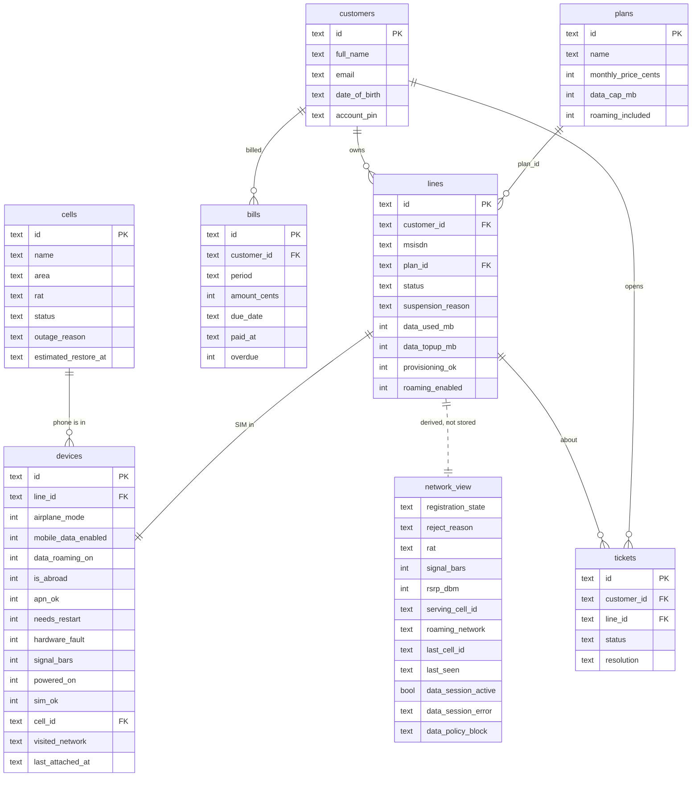

# Northwind Mobile: support agent practice world

A forward-deployed-engineer (FDE) practice project modeled on Sierra's
[τ²-bench](https://arxiv.org/abs/2506.07982) telecom domain: a support agent and a
customer **both** act on a shared world. The agent controls the carrier's systems; only the
customer can touch their phone.

This repo is **just the world**: a SQLite database, seed data, scenarios and a checker.
There are no tools, no agent, no LLM calls and no logging yet. Building those is the exercise.
Optionally, tickets can live in a real **ServiceNow** instance and lines/devices behind a **mock network API**
(billing stays in SQLite; Stripe test mode is an optional extra). See [External systems](#external-systems-optional-realistic-mode).

## The client

**Northwind Mobile** is a regional carrier. Its biggest support queue is
*"my data isn't working"*. Most of those tickets come down to a handful of causes: airplane mode
left on, mobile data switched off, a line suspended for an unpaid bill, a used-up data cap, a
broken network profile after a SIM swap, a phone that needs a restart, a SIM knocked loose, roaming off
abroad, or a local tower outage that has nothing to do with the phone at all.

Northwind wants an **autonomous agent** that resolves these tickets end to end, knows when to hand
off to a human, and leaves a **full log** of every step so their team can see why it succeeded or failed.
They will only launch it if you can show a measured pass rate on realistic test cases.

The catch (the τ²-bench point): half of the fixes happen on the customer's phone. The agent can't
see the phone or flip its settings. It has to ask the customer to check things and do things, then
trust what comes back. What the carrier *can* see is the network side: whether the phone is registered,
on which tower, whether a data session is up. That shows symptoms, not causes (see [Network view](#network-view-what-the-carrier-can-and-cant-see)).

## What's here

```
schema.sql                 tables: plans, cells, customers, lines, bills, devices, tickets
northwind/
  db.py                    connect(), fresh_db(), insert_rows(), plan + cell reference data
  network.py               DERIVED carrier network view of a line: get_network_status(), data_works()
  seed.py                  python -m northwind.seed -> northwind.db with 12 realistic customers
  scenarios.py             list_scenarios(), load_scenario(), check_end_state()
  scenarios/*.json         14 test scenarios: initial state + expected end state
tests/
  test_seed.py             seed counts, FK integrity, schema constraints
  test_scenarios.py        every scenario loads, fails before, passes when the expected state is applied
  test_network.py          network view: symptoms not causes, carrier-side attribution, outages, roaming
  test_mock_network.py     mock API (skipped if fastapi isn't installed)
  test_integrations.py     live-key refusal, config, sync payloads (no network)

# optional realistic mode (see "External systems")
mock_network/app.py        FastAPI mock carrier network + device API over the SQLite DB (incl. /lines/{id}/network, /cells)
northwind/integrations.py  env loading, Stripe test-key guard, ServiceNow config
scripts/check_*.py         one harmless read against ServiceNow / Stripe
scripts/sync_*.py          idempotent push of seed/scenario data to ServiceNow / Stripe
.env.example               env var names; copy to .env (gitignored)
requirements-integrations.txt
```

## Schema

Who can see/change what matters. **Carrier side** (agent): `customers`, `lines`, `bills`,
`plans`, `cells`, `tickets`, plus the derived **network view**. **Device side** (customer only): `devices`.



Rules baked into the schema (CHECK constraints): a line is `suspended` **if and only if** it has a
`suspension_reason`; a bill can't be both paid and overdue. So related columns must change in **one**
`UPDATE` (e.g. resuming a line sets `status='active', suspension_reason=NULL` together).

`devices.signal_bars` is the RF coverage where the phone physically is (0 = dead zone). It is not what
the status bar shows: a phone in airplane mode still has `signal_bars = 4` here, but shows no service.

## Network view: what the carrier can and can't see

Real carriers can't read a phone's settings, but their core network sees what the phone *does*. That
view is **derived** on the fly by `northwind/network.py` from line + device + cell state, never
stored, so it can't drift out of sync when the customer flips a setting. Read it with
`get_network_status(conn, line_id)` or `GET /lines/{id}/network` on the mock API.

| Field | Meaning |
|---|---|
| `registration_state` | `registered`, `rejected` (network refused it), or `not_registered` (no contact) |
| `reject_reason` | `line_suspended`, `line_cancelled`, `roaming_not_allowed` |
| `rat`, `signal_bars`, `rsrp_dbm` | `5G` / `LTE` / `none`, reported signal |
| `serving_cell_id` / `roaming_network` | home tower, or partner network when abroad |
| `last_cell_id` | last tower the phone was heard on, even after it dropped off (use with `cells` to spot an outage) |
| `last_seen` | now if in contact, else when the phone dropped off |
| `data_session_active` | **this is "data works"** |
| `data_session_error` | `unknown_apn` (bad provisioning or handset APN) |
| `data_policy_block` | `cap_reached` |

**Symptoms, not causes.** This is the point of the exercise:

| Situation | Carrier sees | Can the carrier tell the cause? |
|---|---|---|
| Airplane mode on / phone off / SIM unseated / needs restart / water damage / dead zone | `not_registered`, `last_seen` 2h ago | **No.** All look identical. Ask the customer. |
| Mobile data switched off | `registered`, no data session, no error | **No.** Could also just be idle. Ask the customer. |
| Data roaming off on the phone (abroad) | registered on partner network, no data session | **No.** |
| Line suspended / cancelled | `rejected`, `line_suspended` | Yes (and `lines` says why) |
| Abroad without roaming on the line | `rejected`, `roaming_not_allowed` | Yes |
| Data cap reached | `data_policy_block = cap_reached` | Yes |
| Bad APN / provisioning | `data_session_error = unknown_apn` | Partly: carrier can re-push the profile |
| Tower outage | `not_registered`, `last_cell_id` = the downed tower; `cells` shows `outage` + restore ETA | Yes, if the agent checks `cells` |

**When does data actually work?** `data_session_active` is true when all of these hold:
- the radio reaches a network: phone on, not in airplane mode, SIM OK, no pending restart, no hardware
  fault, `signal_bars > 0`, and the cell isn't in outage (or the phone is abroad)
- the registration is accepted: the line is `active`, and if abroad the line has `roaming_enabled = 1`
- the phone asks for data: `mobile_data_enabled = 1`, and if abroad `data_roaming_on = 1`
- the data session can open: `apn_ok = 1`, `provisioning_ok = 1`, and `data_used_mb < plan cap + data_topup_mb`

`data_works(conn, line_id)` returns exactly this. Your `run_speed_test` device tool should use it.

## Scenarios

Each JSON file has `initial_state` (rows to insert), `customer_persona` (for your simulated user),
`opening_message`, `root_causes`, `notes`, and `expected_end_state`. Every scenario uses the same ids
(`CUS-1001`, `LIN-2001`, `BIL-3001/3002`, `DEV-4001`, `TKT-5001`) because each one loads into its own fresh DB.

| id | difficulty | what's wrong | correct outcome |
|---|---|---|---|
| s01_airplane_mode | easy | airplane mode on | turned off, ticket resolved |
| s02_mobile_data_off | easy | mobile data off | turned on |
| s03_suspended_overdue_bill | medium | suspended, overdue bill | bill paid, line resumed |
| s04_data_cap_reached | medium | cap used up | ≥1 GB top-up, plan unchanged |
| s05_bad_apn_provisioning | medium | broken profile after SIM swap | provisioning reset, APN fixed |
| s06_needs_restart | easy | stale radio after update | phone restarted |
| s07_roaming_abroad | medium | abroad, roaming off both sides | carrier + phone roaming on |
| s08_airplane_and_data_off | medium | two device problems | both fixed |
| s09_suspended_and_restart | hard | suspended + needs restart | pay, resume, restart |
| s10_cap_and_data_off | hard | cap hit + data turned off | top-up + data on |
| s11_hardware_fault | medium | water damage | **escalated**, not resolved |
| s12_fraud_hold | hard | fraud hold, customer insists | **stays suspended**, escalated |
| s13_tower_outage | medium | local tower down (phone is fine) | told it's an outage (resolution mentions it), **not** escalated, phone and line untouched |
| s14_sim_unseated | medium | SIM knocked loose (looks like s01 from the network) | SIM reseated |

Most scenarios also expect the derived network view to end up healthy:
`"network": {"LIN-2001": {"registration_state": "registered", "data_session_active": true}}`.

The checker compares the DB to `expected_end_state`, either by exact value or with an operator:

```json
"expected_end_state": {
  "lines":   {"LIN-2001": {"status": "active", "data_topup_mb": {"op": "gte", "value": 1024}}},
  "tickets": {"TKT-5001": {"status": "resolved"}}
}
```

Operators: `eq ne gt gte lt lte in not_in is_null not_null contains` (`contains` is a case-insensitive substring).
The pseudo-table `network` (keyed by line id) checks the derived network view.

## How do we grade fixes we can't see?

The agent can't see the phone, but **the grader can**. Grading never relies on what the agent or
the customer *says*. It checks the actual end state:

1. **Ground truth beats the transcript.** The simulated customer's tools really change `devices`.
   After the run, `check_end_state` reads `devices`, `lines`, `bills`, `tickets` and the derived
   network view. If the agent said "fixed!" but airplane mode is still on, it fails.
2. **The network view is the agent's own way to check.** Mid-conversation it can call the network
   status after asking the customer to do something: "I see your phone registered on our network
   again, and a data session is up." That's how a real agent confirms a fix it can't see, and it's
   the habit that beats "stopping after the first fix" (s08–s10).
3. **Outcome, not effort.** s13 (outage) passes only if the phone and line are left untouched,
   the customer is told it's an outage, and the ticket isn't escalated. s11 and s12 pass only when the
   agent escalates. Doing more isn't better.
4. **A simulated customer who can err.** Because it's simulated, you control how reliable it is.
   Make it sometimes misreport ("yeah, airplane mode's off" when it isn't) and see whether your agent
   checks the network view instead of trusting it. Your logs show which step went wrong.
5. **Pass rate over many runs.** LLM runs vary, so run each scenario N times and report pass^k
   (passed all k tries) as well as the average. τ²-bench reports it the same way.

## Run it

Python 3.10+ and only `pytest`.

```bash
python -m venv .venv && source .venv/bin/activate
pip install -r requirements.txt

python -m northwind.seed                        # creates northwind.db (12 customers, 9 open tickets, 1 tower outage)
sqlite3 northwind.db "SELECT * FROM tickets"    # poke around (or use any SQLite viewer)

python -m northwind.scenarios                   # list scenarios
python -m northwind.scenarios s03_suspended_overdue_bill          # load in memory and show what's unsolved
python -m northwind.scenarios s03_suspended_overdue_bill run.db   # load into a file you can inspect

pytest                                          # 140 tests with integrations installed (mock API tests skip without fastapi)
```

Using it from code:

```python
from northwind.scenarios import list_scenarios, load_scenario_file, load_scenario, check_end_state

scenario = load_scenario_file("s01_airplane_mode")
conn = load_scenario(scenario)          # fresh in-memory DB in the initial state
# ... your agent and simulated user change the DB through their tools ...
result = check_end_state(conn, scenario)
print(result)                           # PASS, or FAIL with every mismatch listed
```

## External systems (optional, realistic mode)

Real FDE work means your agent talks to the client's actual systems, not one tidy database. In
realistic mode the world is split across systems, the way it would be at a real carrier. The default
setup uses **ServiceNow + the mock network API**; billing stays in SQLite.

| Data | Owner system | How you reach it |
|---|---|---|
| Customers (CRM-ish identity: name, DOB, PIN) | **SQLite** | `northwind.db` |
| Bills | **SQLite** by default. *Optional:* Stripe test mode (Customers + Invoices) | `northwind.db`, or the Stripe API with an `sk_test_...` key |
| Tickets | **ServiceNow** `incident` table (free Personal Developer Instance) | Table API, `https://<instance>.service-now.com/api/now/table/incident`, basic auth |
| Lines, devices, cells, network view | **Mock network API** in `mock_network/` (no free real version exists) | `http://localhost:8300` |

SQLite is still the source the sync scripts read from, and the scenario checker still reads SQLite.
These scripts only **set up** the external systems. Your agent's tools, the loop, and logging are still yours to write.

### 1. ServiceNow Personal Developer Instance (tickets)

1. Go to [developer.servicenow.com](https://developer.servicenow.com), click **Sign up**, confirm the
   email, and sign in. This is your ServiceNow ID, not your instance login.
2. Click **Request Instance**, pick the newest release, click **Request**. It takes a few minutes. If
   none are free, you can **Join Waitlist**.
3. Open **Manage my Instance**. It shows your instance URL (like `https://dev12345.service-now.com`),
   the username `admin`, and the password (click the eye icon).
4. Put them in `.env` as `SERVICENOW_INSTANCE`, `SERVICENOW_USER`, `SERVICENOW_PASSWORD`.
5. `python scripts/check_servicenow.py` should print `OK`.

Things to know:
- **Hibernation:** PDIs sleep when idle and return an HTML page instead of JSON. Sign in to the developer
  site, or use Manage my Instance > **Wake Instance**, then wait a few minutes.
- **Reclaimed after 10 days without activity:** the instance is reset and given to someone else. The sync
  script can recreate the incidents any time.
- **Production use isn't allowed:** PDIs are for learning only. Use the `admin` user here; for anything
  closer to production you'd create a dedicated integration user with the `itil` role.

API used (Table API, JSON, basic auth):
```
GET  /api/now/table/incident?sysparm_limit=1                              # check script
GET  /api/now/table/incident?sysparm_query=correlation_id=<id>&sysparm_limit=1   # find existing
POST /api/now/table/incident   {"short_description": ..., "correlation_id": ...} # create, returns 201
```
Incident `state` values used: `1` New, `2` In Progress. When your agent resolves or escalates, it'll
PATCH `/api/now/table/incident/<sys_id>`. Look up the resolve fields on your instance
(`close_code`, `close_notes`, state 6) rather than guessing.

### 2. Mock network API (lines, devices, cells, network view)

```bash
NORTHWIND_DB=northwind.db uvicorn mock_network.app:app --port 8300   # docs: http://localhost:8300/docs
```

| Method | Path | Notes |
|---|---|---|
| GET | `/health` | which DB it's serving |
| GET | `/lines?msisdn=...` or `?customer_id=...` | find lines |
| GET / PATCH | `/lines/{line_id}` | status, suspension_reason, plan_id, data_used_mb, data_topup_mb, provisioning_ok, roaming_enabled |
| GET | `/lines/{line_id}/network` | **carrier's network view** (derived). Agent may read this |
| GET | `/cells?status=outage`, `/cells/{cell_id}` | towers and outages (NOC view). Agent may read this |
| PATCH | `/cells/{cell_id}` | network ops: start/end an outage. 403 for the agent |
| GET | `/lines/{line_id}/device` | the handset on that line |
| GET / PATCH | `/devices/{device_id}` | airplane_mode, mobile_data_enabled, data_roaming_on, is_abroad, apn_ok, needs_restart, hardware_fault, signal_bars, powered_on, sim_ok, cell_id, visited_network |

- It only stores state. It doesn't enforce business rules like "pay before resume"; your tools do.
  It does enforce the schema: `{"status": "active"}` on a suspended line returns **409** until you
  also send `"suspension_reason": null`. Unknown fields or bad values return **422**.
- **Information asymmetry:** send `X-Actor: agent` from agent-side code. The device endpoints return
  **403** for it, because only the customer can see their phone. Your simulated user's tools call
  the device endpoints with `X-Actor: user`. The agent's substitute is `/lines/{id}/network` plus `/cells`.
- `last_seen` is maintained for you: before a device or cell change that takes a phone off the
  network, the API stamps `last_attached_at` with the current time.

### 3. Stripe test mode (optional: billing)

Skip this unless you want billing in a real external system too. By default bills stay in SQLite
(`bills` table) and your billing tools read and write that.

1. Create an account at [dashboard.stripe.com/register](https://dashboard.stripe.com/register). You don't
   need to activate payments or add bank details to use a sandbox.
2. Make sure you're in a **sandbox** (test mode). Stripe recommends a separate sandbox for each new integration.
3. Open the **API keys** page (Developers > API keys) and reveal the **secret key**. Sandbox secret keys
   start with `sk_test_`. Put it in `.env` as `STRIPE_SECRET_KEY`.
4. **Never use a live key** (`sk_live_...`). Every script here refuses one before making any call.
5. `python scripts/check_stripe.py` should print `OK`.

Tip: a restricted key (`rk_test_...`) with only Customers + Invoices + Invoice Items write access also
works and is safer. Stripe recommends restricted keys over secret keys.

### Setup

```bash
pip install -r requirements-integrations.txt
cp .env.example .env          # fill in the values; .env is gitignored
python -m northwind.seed
python scripts/check_servicenow.py
python scripts/sync_servicenow.py --dry-run && python scripts/sync_servicenow.py   # 9 tickets -> incidents
NORTHWIND_DB=northwind.db uvicorn mock_network.app:app --port 8300

# optional, only if you want billing in Stripe:
python scripts/check_stripe.py
python scripts/sync_stripe.py --dry-run && python scripts/sync_stripe.py           # 12 customers, 36 invoices
```

| Env var | Used by |
|---|---|
| `SERVICENOW_INSTANCE` | `dev12345` or `https://dev12345.service-now.com` |
| `SERVICENOW_USER`, `SERVICENOW_PASSWORD` | basic auth for the Table API |
| `STRIPE_SECRET_KEY` | optional; `sk_test_...` / `rk_test_...` only |
| `NETWORK_API_URL` | where your tools find the mock API (default `http://localhost:8300`) |

The sync scripts are **idempotent**, so you can run them again without creating duplicates:
- **ServiceNow:** each incident gets `correlation_id = northwind-<tag>-<ticket id>`, and existing ones are skipped.
- **Stripe (optional):** customers are matched by email plus `northwind_tag` metadata, and invoices by `northwind_bill_id` metadata.
- **Paid vs. overdue bills:** paid bills become invoices that are finalized and marked paid out of band, so no charge is made.
  Unpaid ones stay `open`. Stripe won't take a past due date, so the real due date and the overdue flag are stored in
  metadata (`northwind_due_date`, `northwind_overdue`). Your billing tool should read `northwind_overdue`, and
  paying an overdue bill can use the same paid-out-of-band call.

### Using it with scenarios

Load a scenario into a file, then point every system at it with a tag so runs don't collide:

```bash
python -m northwind.scenarios s03_suspended_overdue_bill run.db
python scripts/sync_servicenow.py --db run.db --tag s03    # incident northwind-s03-TKT-5001
NORTHWIND_DB=run.db uvicorn mock_network.app:app --port 8300   # LIN-2001 suspended, network view "rejected"
# optional: python scripts/sync_stripe.py --db run.db --tag s03   # BIL-3001 open + northwind_overdue=1
```

| Scenario needs | Fixed in |
|---|---|
| airplane mode, mobile data, data roaming, restart, APN, SIM (s01, s02, s05, s06, s07, s08, s14) | mock API `/devices` (user side) |
| suspended line, top-up, provisioning reset, carrier roaming (s03, s04, s05, s07, s09, s10) | mock API `/lines` (agent side) |
| checking a fix worked, spotting an outage (all; s13 especially) | mock API `/lines/{id}/network` and `/cells` (agent side, read-only) |
| overdue bill paid (s03, s09) | SQLite `bills` (or the Stripe invoice, if you enabled Stripe) |
| ticket resolved or escalated (all; s11 and s12 must escalate, s13 must not) | ServiceNow incident |

`check_end_state` reads SQLite (and derives the network view from it). The mock API writes to SQLite
directly. For ServiceNow (and Stripe, if used), your eval step should copy the final incident state
and resolution notes back into the scenario DB's `tickets` row before checking (a small "pull" step you
write), or you can extend the checker to query them.

## Your tasks

Build these yourself, roughly in order. Get each working before starting the next.

1. **Tools.** `northwind/carrier_tools.py` for the agent (e.g. `get_customer`, `get_line_status`,
   `get_billing`, `pay_bill`, `get_network_status`, `check_area_outages`,
   `resume_line` (only if no overdue bill and never for `fraud_hold`),
   `reset_network_provisioning` (also fixes the handset APN), `add_data_topup`, `enable_roaming`,
   `update_ticket`/`escalate_to_human`) and `northwind/device_tools.py` for the customer
   (`check_status_bar`, `toggle_airplane_mode`, `toggle_mobile_data`, `toggle_data_roaming`,
   `restart_device`, `reseat_sim`, `run_speed_test`). Agent tools must never read `devices`; they get
   the network view instead. Each takes a connection, reads/writes SQLite, and returns a dict.
   Add a registry with JSON-schema descriptions so an LLM can call them. Unit-test them.
   In realistic mode, ticket tools call ServiceNow and line/device/network tools call the mock network API.
2. **Agent loop.** An LLM that gets the ticket and the carrier tools and loops
   think → call a tool or message the customer → read the result, until it resolves, escalates,
   or hits a max-turn cap. It must never call device tools itself.
3. **Simulated customer.** A second LLM that gets only the device tools, the scenario's
   `customer_persona` and `opening_message`. It doesn't know the root cause, answers from what its
   tools actually show, and does what the agent asks (or gets it slightly wrong, per persona).
4. **Logging.** Add `runs` / `run_steps` tables: run id, scenario id, step index, actor
   (agent/user/system), message, tool name, args and result JSON, state snapshot before/after,
   latency, tokens, timestamp. Write a replay script that prints a run step by step.
5. **Evaluation.** For each scenario: `load_scenario` → run agent + simulated user →
   `check_end_state`. Repeat N times per scenario and report the pass rate per scenario and overall.
   A hard-coded scripted agent makes a useful baseline to compare against.
6. **Failure analysis.** Read the failed runs in your logs, group them (wrong diagnosis, stopped after
   the first fix, gave the customer an impossible instruction, broke policy), change the prompt or
   tools, rerun, and show the before/after pass rate.
7. **Stretch.** Policies (verify identity with DOB or PIN before any change), an alert when the pass
   rate drops after a prompt change, and a handoff summary written into `tickets.resolution` on escalation.

## Traps to watch for

- **Stopping after the first fix** (s08, s09, s10): always re-run the speed test before resolving.
- **Policy** (s03, s12): don't resume a line with an overdue bill; never lift a fraud hold.
- **Knowing when to give up** (s11): escalation is the correct, passing outcome.
- **Not the phone** (s13): check `cells` for an outage before sending the customer through ten device steps.
- **Same symptom, different cause** (s01 vs s14): the network view is identical, so only questions to the customer tell them apart.
- **Verify, don't trust**: after each customer step, check the network view.
- **Information asymmetry**: the agent can't read `devices`. If your agent queries that table, it's cheating.
