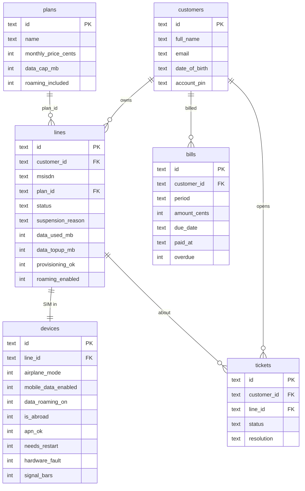

# Northwind Mobile: support agent practice world

A forward-deployed-engineer (FDE) practice project modeled on Sierra's
[τ²-bench](https://arxiv.org/abs/2506.07982) telecom domain: a support agent and a
customer **both** act on a shared world. The agent controls the carrier's systems; only the
customer can touch their phone.

This repo is **just the world**: a SQLite database, seed data, scenarios and a checker.
There are no tools, no agent, no LLM calls and no logging yet. Building those is the exercise.

## The client

**Northwind Mobile** is a regional carrier. Its biggest support queue is
*"my data isn't working"*. Most of those tickets come down to a handful of causes: airplane mode
left on, mobile data switched off, a line suspended for an unpaid bill, a used-up data cap, a
broken network profile after a SIM swap, a phone that needs a restart, or roaming off abroad.

Northwind wants an **autonomous agent** that resolves these tickets end to end, knows when to hand
off to a human, and leaves a **full log** of every step so their team can see why it succeeded or failed.
They will only launch it if you can show a measured pass rate on realistic test cases.

The catch (the τ²-bench point): half of the fixes happen on the customer's phone. The agent can't
see the phone or flip its settings. It has to ask the customer to check things and do things, then
trust what comes back.

## What's here

```
schema.sql                 tables: plans, customers, lines, bills, devices, tickets
northwind/
  db.py                    connect(), fresh_db(), insert_rows(), plan reference data
  seed.py                  python -m northwind.seed -> northwind.db with 12 realistic customers
  scenarios.py             list_scenarios(), load_scenario(), check_end_state()
  scenarios/*.json         12 test scenarios: initial state + expected end state
tests/
  test_seed.py             seed counts, FK integrity, schema constraints
  test_scenarios.py        every scenario loads, fails before, passes when the expected state is applied
```

## Schema

Who can see/change what matters. **Carrier side** (agent): `customers`, `lines`, `bills`,
`plans`, `tickets`. **Device side** (customer only): `devices`.



Rules baked into the schema (CHECK constraints): a line is `suspended` **if and only if** it has a
`suspension_reason`; a bill can't be both paid and overdue. So related columns must change in **one**
`UPDATE` (e.g. resuming a line sets `status='active', suspension_reason=NULL` together).

**When does data actually work?** (You'll encode this in a `run_speed_test` tool.) All of:
line `active`; `provisioning_ok = 1`; `data_used_mb < plan cap + data_topup_mb`; device
`airplane_mode = 0`, `mobile_data_enabled = 1`, `apn_ok = 1`, `needs_restart = 0`,
`hardware_fault = 0`, `signal_bars > 0`; and if `is_abroad = 1`, both line `roaming_enabled = 1`
and device `data_roaming_on = 1`.

## Scenarios

Each JSON file has `initial_state` (rows to insert), `customer_persona` (for your simulated user),
`opening_message`, `root_causes`, `notes`, and `expected_end_state`. Every scenario uses the same ids
(`CUS-1001`, `LIN-2001`, `BIL-3001/3002`, `DEV-4001`, `TKT-5001`) because each one loads into its own fresh DB.

| id | difficulty | what's wrong | correct outcome |
|---|---|---|---|
| s01_airplane_mode | easy | airplane mode on | turned off, ticket resolved |
| s02_mobile_data_off | easy | mobile data off | turned on |
| s03_suspended_overdue_bill | medium | suspended, overdue bill | bill paid, line resumed |
| s04_data_cap_reached | medium | cap used up | ≥1 GB top-up, plan unchanged |
| s05_bad_apn_provisioning | medium | broken profile after SIM swap | provisioning reset, APN fixed |
| s06_needs_restart | easy | stale radio after update | phone restarted |
| s07_roaming_abroad | medium | abroad, roaming off both sides | carrier + phone roaming on |
| s08_airplane_and_data_off | medium | two device problems | both fixed |
| s09_suspended_and_restart | hard | suspended + needs restart | pay, resume, restart |
| s10_cap_and_data_off | hard | cap hit + data turned off | top-up + data on |
| s11_hardware_fault | medium | water damage | **escalated**, not resolved |
| s12_fraud_hold | hard | fraud hold, customer insists | **stays suspended**, escalated |

The checker compares the DB to `expected_end_state`, either by exact value or with an operator:

```json
"expected_end_state": {
  "lines":   {"LIN-2001": {"status": "active", "data_topup_mb": {"op": "gte", "value": 1024}}},
  "tickets": {"TKT-5001": {"status": "resolved"}}
}
```

Operators: `eq ne gt gte lt lte in not_in is_null not_null`.

## Run it

Python 3.10+ and only `pytest`.

```bash
python -m venv .venv && source .venv/bin/activate
pip install -r requirements.txt

python -m northwind.seed                        # creates northwind.db (12 customers, 8 open tickets)
sqlite3 northwind.db "SELECT * FROM tickets"    # poke around (or use any SQLite viewer)

python -m northwind.scenarios                   # list scenarios
python -m northwind.scenarios s03_suspended_overdue_bill          # load in memory and show what's unsolved
python -m northwind.scenarios s03_suspended_overdue_bill run.db   # load into a file you can inspect

pytest                                          # 67 tests
```

Using it from code:

```python
from northwind.scenarios import list_scenarios, load_scenario_file, load_scenario, check_end_state

scenario = load_scenario_file("s01_airplane_mode")
conn = load_scenario(scenario)          # fresh in-memory DB in the initial state
# ... your agent and simulated user change the DB through their tools ...
result = check_end_state(conn, scenario)
print(result)                           # PASS, or FAIL with every mismatch listed
```

## Your tasks

Build these yourself, roughly in order. Get each working before starting the next.

1. **Tools.** `northwind/carrier_tools.py` for the agent (e.g. `get_customer`, `get_line_status`,
   `get_billing`, `pay_bill`, `resume_line` (only if no overdue bill and never for `fraud_hold`),
   `reset_network_provisioning` (also fixes the handset APN), `add_data_topup`, `enable_roaming`,
   `update_ticket`/`escalate_to_human`) and `northwind/device_tools.py` for the customer
   (`check_status_bar`, `toggle_airplane_mode`, `toggle_mobile_data`, `toggle_data_roaming`,
   `restart_device`, `run_speed_test`). Each takes a connection, reads/writes SQLite, and returns a dict.
   Add a registry with JSON-schema descriptions so an LLM can call them. Unit-test them.
2. **Agent loop.** An LLM that gets the ticket and the carrier tools and loops
   think → call a tool or message the customer → read the result, until it resolves, escalates,
   or hits a max-turn cap. It must never call device tools itself.
3. **Simulated customer.** A second LLM that gets only the device tools, the scenario's
   `customer_persona` and `opening_message`. It doesn't know the root cause, answers from what its
   tools actually show, and does what the agent asks (or gets it slightly wrong, per persona).
4. **Logging.** Add `runs` / `run_steps` tables: run id, scenario id, step index, actor
   (agent/user/system), message, tool name, args and result JSON, state snapshot before/after,
   latency, tokens, timestamp. Write a replay script that prints a run step by step.
5. **Evaluation.** For each scenario: `load_scenario` → run agent + simulated user →
   `check_end_state`. Repeat N times per scenario and report the pass rate per scenario and overall.
   A hard-coded scripted agent makes a useful baseline to compare against.
6. **Failure analysis.** Read the failed runs in your logs, group them (wrong diagnosis, stopped after
   the first fix, gave the customer an impossible instruction, broke policy), change the prompt or
   tools, rerun, and show the before/after pass rate.
7. **Stretch.** Policies (verify identity with DOB or PIN before any change), an alert when the pass
   rate drops after a prompt change, and a handoff summary written into `tickets.resolution` on escalation.

## Traps to watch for

- **Stopping after the first fix** (s08, s09, s10): always re-run the speed test before resolving.
- **Policy** (s03, s12): don't resume a line with an overdue bill; never lift a fraud hold.
- **Knowing when to give up** (s11): escalation is the correct, passing outcome.
- **Information asymmetry**: the agent can't read `devices`. If your agent queries that table, it's cheating.
